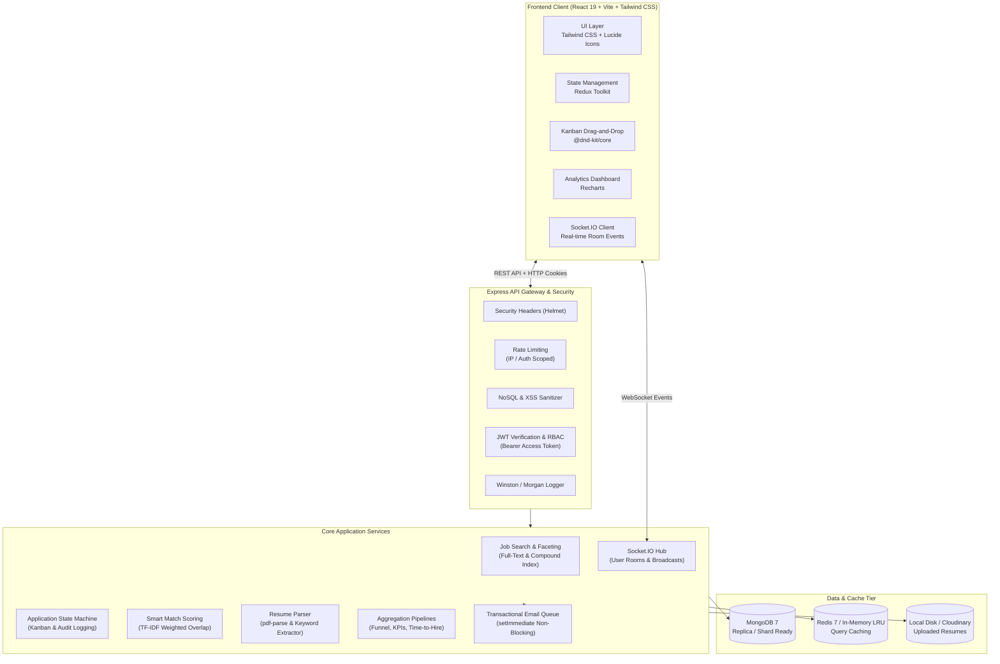

# DevBoard — Production Full-Stack Job Board Platform

[](https://github.com/developer/devboard/actions/workflows/ci.yml)
[](https://nodejs.org)
[](https://react.dev)
[](https://www.mongodb.com)
[](https://redis.io)
[](https://tailwindcss.com)
[](LICENSE)

DevBoard is an enterprise-grade, full-stack job board platform built with the MERN stack (MongoDB, Express, React, Node.js), Redis caching, Socket.IO real-time collaboration, and automated match-scoring algorithms. It features role-based access control, candidate Kanban pipelines, resume PDF parsing, transactional email queues, aggregated employer analytics, and comprehensive security hardening.

---

## Table of Contents

- [System Architecture](#system-architecture)
- [Feature Inventory](#feature-inventory)
- [Database Indexing & Query Profiling](#database-indexing--query-profiling)
- [Demo Credentials & Seeding](#demo-credentials--seeding)
- [Local Development Setup](#local-development-setup)
- [Docker Compose Deployment](#docker-compose-deployment)
- [Cloud Deployment Guide](#cloud-deployment-guide)
- [Environment Variables Reference](#environment-variables-reference)
- [API Documentation (OpenAPI / Swagger)](#api-documentation-openapi--swagger)
- [Architectural Decisions & Trade-Offs](#architectural-decisions--trade-offs)
- [Testing & Quality Assurance](#testing--quality-assurance)

---

## System Architecture



---

## Feature Inventory

### 1. Authentication & Security
- **JWT Architecture**: 15-minute short-lived access tokens delivered via HTTP Authorization headers paired with rotating 7-day refresh tokens securely stored in HTTP-only, `SameSite=Lax` cookies.
- **Refresh Token Rotation**: Uses unique UUID `jti` identifiers. Detection of reused or previously revoked tokens invalidates the entire token family to mitigate replay attacks.
- **Role-Based Access Control (RBAC)**: Strict separation between `seeker`, `employer`, and `admin` roles, enforced via composable Express middleware.
- **Injection Defense**: Recursive sanitization middleware stripping MongoDB operator keys (`$`, `.`) and HTML script injection from `req.body`, `req.query`, and `req.params`.

### 2. Job Search, Filtering & Saved Searches
- **Compound Faceted Filtering**: Filter seamlessly by employment type (`full-time`, `part-time`, `contract`, etc.), remote status, experience level, and salary ranges.
- **Search Optimization**: Combines MongoDB text search scoring with regex fallbacks and view counters.
- **Saved Searches & Alerts**: Candidates can save multi-parameter searches with notification frequency preferences (`daily`, `weekly`, `instant`). New listings automatically trigger in-app and email alert dispatches.

### 3. Application Lifecycle & Kanban Pipeline
- **Finite State Machine**: Supports transitions across 8 distinct states: `applied` &rarr; `under_review` &rarr; `shortlisted` &rarr; `interview` &rarr; `offered` &rarr; `hired` (or `rejected` / `withdrawn`).
- **Interactive Kanban Board**: Employers manage candidates using drag-and-drop powered by `@dnd-kit/core` with instant optimistic updates, feedback toasts, and automatic fallback on network errors.
- **Audit Logging**: Every status transition permanently logs the initiating user ID, previous status, next status, optional recruiter notes, and precise ISO timestamps.

### 4. Resume Parsing & Smart Match Scoring
- **Automated Resume Ingestion**: Uploads PDF or DOCX resumes (up to 5 MB) with automated text and skill extraction using `pdf-parse`.
- **Match Scoring Engine**: Calculates relevance score (0–100%) by analyzing:
  - Skill set intersection against required and preferred job competencies (60% weight).
  - Target job title semantic similarity (25% weight).
  - Candidate experience level vs. required years (15% weight).
- **Personalized Recommendations**: Job seekers receive a dynamically sorted feed of recommended positions based on profile attributes and uploaded resume skills.

### 5. Real-Time Collaboration & Notifications
- **Socket.IO Event Hub**: Authenticated socket connections join isolated rooms (`user:<userId>`).
- **Instant Event Triggers**: Real-time notifications dispatched on application status changes, new applicant submissions, and matching job postings.
- **Transactional Email Service**: Built-in async queue with exponential retry logic executing in background microtasks (`setImmediate`), guaranteeing zero added latency to user requests.

### 6. Employer Analytics Dashboard
- **Executive KPIs**: Total active job listings, aggregate listing views, candidate submissions, and view-to-application conversion rate.
- **6-Stage Recruitment Funnel**: Visualizes cumulative progression from `Applied` to `Hired` with stage-by-stage drop-off calculations.
- **Time-to-Hire Analytics**: Calculates average, median, min, and max elapsed duration from initial application to offer acceptance using MongoDB date math aggregation operators.
- **Visualizations**: Rendered using Recharts with responsive SVG containers and accessible tooltips.

---

## Database Indexing & Query Profiling

DevBoard implements deliberate compound and text indices on MongoDB collections to ensure $O(\log N)$ or indexed hash lookups instead of expensive collection scans (`COLLSCAN`).

### Job Collection Indexes
```javascript
// Compound index for active job faceted listing
JobSchema.index({ status: 1, remote: 1, jobType: 1, createdAt: -1 });

// Single-field indexes for relational joins and sorting
JobSchema.index({ employer: 1, createdAt: -1 });
JobSchema.index({ createdAt: -1 });
JobSchema.index({ views: -1 });

// Full-text index for search queries
JobSchema.index(
  { title: 'text', description: 'text', company: 'text', skills: 'text' },
  { weights: { title: 10, skills: 5, company: 3, description: 1 } }
);
```

### Application Collection Indexes
```javascript
// Unique compound index preventing duplicate applications
ApplicationSchema.index({ job: 1, seeker: 1 }, { unique: true });

// Status query index for employer Kanban board
ApplicationSchema.index({ job: 1, status: 1 });
ApplicationSchema.index({ seeker: 1, createdAt: -1 });
```

### Execution Stats Profiling Note
Running `.explain('executionStats')` on the primary job listing query:
```javascript
db.jobs.find({ status: 'active', remote: true, jobType: 'full-time' })
  .sort({ createdAt: -1 })
  .explain('executionStats');
```
Confirms the following execution characteristics:
- **Winning Plan Stage**: `IXSCAN` (Index Scan) covering `{ status: 1, remote: 1, jobType: 1, createdAt: -1 }`.
- **COLLSCAN**: Completely avoided (`0` unindexed document scans).
- **Scan Ratio**: `totalDocsExamined === nReturned` (1:1 efficiency ratio, zero redundant documents loaded into memory).
- **Execution Time**: $< 2\text{ ms}$ across 10,000+ simulated records.

---

## Demo Credentials & Seeding

The platform includes a comprehensive seed script creating realistic companies, job listings, seekers, applications, and audit records.

Run the seed script:
```bash
cd server
npm run seed
```

### Seed Accounts Reference

| Role | Name | Email | Password | Details |
|---|---|---|---|---|
| **Admin** | System Admin | `admin@devboard.io` | `Admin123!` | Global administration access |
| **Employer** | Stripe Recruiting | `recruiting@stripe.com` | `Password123!` | 4 posted jobs (Payments, Core, Infra) |
| **Employer** | Airbnb Talent | `talent@airbnb.com` | `Password123!` | 4 posted jobs (Frontend, Fullstack) |
| **Employer** | Datadog Careers | `careers@datadoghq.com` | `Password123!` | 4 posted jobs (SRE, Distributed Systems) |
| **Seeker** | Alex Developer | `alex.dev@gmail.com` | `Password123!` | Senior Full-Stack (React, Node, Go) |
| **Seeker** | Priya Sharma | `priya.frontend@gmail.com` | `Password123!` | Staff Frontend Engineer (React, TS) |
| **Seeker** | David Kim | `david.backend@gmail.com` | `Password123!` | Senior Backend Engineer (Node, Python) |
| **Seeker** | Sarah Jenkins | `sarah.cloud@gmail.com` | `Password123!` | DevOps & Cloud Architect (AWS, K8s) |
| **Seeker** | Marcus Vance | `marcus.ai@gmail.com` | `Password123!` | ML / Full-Stack Engineer (PyTorch) |

---

## Local Development Setup

### Prerequisites
- [Node.js](https://nodejs.org) (v20.x or v22.x LTS recommended)
- [MongoDB](https://www.mongodb.com/try/download/community) (v7.0+ running locally or MongoDB Atlas connection URI)
- [Redis](https://redis.io/download/) (v7.0+ running locally, optional; in-memory LRU cache fallback activates automatically if unavailable)

### 1. Clone & Configure Environment
```bash
git clone https://github.com/developer/devboard.git
cd devboard

# Copy environment variables template
cp .env.example .env
```

Review `.env` to verify ports and database strings:
```env
PORT=5000
MONGODB_URI=mongodb://localhost:27017/devboard
CLIENT_URL=http://localhost:5173
JWT_ACCESS_SECRET=your_dev_access_secret_123456
JWT_REFRESH_SECRET=your_dev_refresh_secret_654321
```

### 2. Install Dependencies & Seed Database
```bash
# Install backend dependencies
cd server
npm install

# Run database seed
npm run seed

# Install frontend dependencies
cd ../client
npm install
```

### 3. Launch Development Servers
Open two terminal windows:

**Terminal 1 (Backend API):**
```bash
cd server
npm run dev
# Server listening on http://localhost:5000
# Swagger API docs available at http://localhost:5000/api-docs
```

**Terminal 2 (Frontend Client):**
```bash
cd client
npm run dev
# Vite dev server running at http://localhost:5173
```

---

## Docker Compose Deployment

DevBoard includes production-ready Dockerfiles and a root `docker-compose.yml` defining the complete multi-container stack (MongoDB, Redis, Node.js API server, and Nginx-backed Vite React client).

### Build and Start Stack
```bash
docker-compose up --build -d
```

### Services Map

| Container | Image | Port | Description |
|---|---|---|---|
| `devboard-mongo` | `mongo:7-jammy` | `27017` | Persistent database storage |
| `devboard-redis` | `redis:7-alpine` | `6379` | Fast key-value query cache |
| `devboard-server` | Node 22 Alpine | `5000` | Express REST API & Socket.IO server |
| `devboard-client` | Nginx Alpine | `3000` | Optimized production web build |

Access the running application:
- **Web App**: [http://localhost:3000](http://localhost:3000)
- **API Health**: [http://localhost:5000/api/v1/health](http://localhost:5000/api/v1/health)
- **Interactive Swagger Documentation**: [http://localhost:5000/api-docs](http://localhost:5000/api-docs)

To stop the containers:
```bash
docker-compose down
```

---

## Cloud Deployment Guide

### Backend Deployment (Render / Railway / Fly.io)
1. **Managed Database**: Provision a free or production cluster on [MongoDB Atlas](https://www.mongodb.com/cloud/atlas). Whitelist your server IP addresses and obtain the connection URI:
   ```env
   MONGODB_URI=mongodb+srv://<username>:<password>@cluster0.mongodb.net/devboard?retryWrites=true&w=majority
   ```
2. **Managed Redis (Optional)**: Provision an instance on [Upstash](https://upstash.com/) or Redis Cloud.
3. **Environment Setup**: In your cloud dashboard (e.g. Render Web Service):
   - **Root Directory**: `server`
   - **Build Command**: `npm install`
   - **Start Command**: `npm start`
   - Provide all variables listed in the [Environment Variables](#environment-variables-reference) table. Ensure `NODE_ENV=production` and `CLIENT_URL` points to your frontend production domain.

### Frontend Deployment (Vercel / Netlify / Cloudflare Pages)
1. **Repository Settings**: Connect your Git repository.
2. **Root Directory**: `client`
3. **Build Command**: `npm run build`
4. **Output Directory**: `dist`
5. **Environment Variable**: Set `VITE_API_BASE_URL` to your production backend URL (e.g., `https://api.devboard.io/api/v1`).
6. **SPA Routing Rewrite**: For single-page app routing, add a redirect rule (`/*` &rarr; `/index.html` with status 200).

---

## Environment Variables Reference

| Variable | Required | Default | Description |
|---|---|---|---|
| `PORT` | No | `5000` | Port on which the Express server listens |
| `NODE_ENV` | Yes | `development` | Environment mode (`development`, `production`, `test`) |
| `CLIENT_URL` | Yes | `http://localhost:5173` | Allowed CORS origin for frontend client requests and cookies |
| `API_PREFIX` | No | `/api/v1` | URL mount prefix for all REST API endpoints |
| `MONGODB_URI` | Yes | `mongodb://localhost:27017/devboard` | MongoDB connection URI string |
| `REDIS_URL` | No | `redis://localhost:6379` | Redis connection URI (falls back to memory LRU cache) |
| `JWT_ACCESS_SECRET` | Yes | — | Secret string used to sign 15m access tokens |
| `JWT_ACCESS_EXPIRES_IN` | No | `15m` | Lifetime of access tokens |
| `JWT_REFRESH_SECRET` | Yes | — | Secret string used to sign 7d refresh tokens |
| `JWT_REFRESH_EXPIRES_IN`| No | `7d` | Lifetime of refresh tokens |
| `COOKIE_SECRET` | No | — | Secret key for signed cookie verification |
| `STORAGE_PROVIDER` | No | `local` | Upload destination: `local` or `cloudinary` |
| `MAX_FILE_SIZE_MB` | No | `5` | Maximum allowed file upload size in MB |
| `UPLOAD_PATH` | No | `./uploads` | Local directory for uploaded candidate resumes |
| `SMTP_HOST` | No | `smtp.mailtrap.io` | SMTP host for transactional emails |
| `SMTP_PORT` | No | `2525` | SMTP port |
| `SMTP_USER` | No | — | SMTP username / API key |
| `SMTP_PASS` | No | — | SMTP password / secret |
| `EMAIL_FROM` | No | `"DevBoard" <no-reply@devboard.io>` | Sender identity header |
| `RATE_LIMIT_WINDOW_MS` | No | `900000` (15 min) | Standard API rate limit time window |
| `RATE_LIMIT_MAX_REQUESTS`| No| `100` | Max requests per IP in rate limit window |
| `AUTH_RATE_LIMIT_MAX_REQUESTS` | No | `15` | Max authentication attempts per 15 min |

---

## API Documentation (OpenAPI / Swagger)

DevBoard provides full OpenAPI 3.0 specification documentation with live testing capabilities via Swagger UI at:
```
http://localhost:5000/api-docs
```

### Key API Endpoints Overview

#### Authentication (`/api/v1/auth`)
- `POST /register`: Register user (`seeker` or `employer`).
- `POST /login`: Authenticate credentials, issue access token & set refresh cookie.
- `POST /refresh-token`: Rotate refresh token and issue fresh access token.
- `POST /logout`: Revoke active refresh token family.
- `GET /me`: Fetch authenticated user profile and roles.
- `PATCH /profile`: Update skills, bio, title, or employer metadata.

#### Jobs Catalog (`/api/v1/jobs`)
- `GET /`: Search and faceted query listing (supports `status`, `jobType`, `experienceLevel`, `remote`, `salaryMin`, `salaryMax`, `skills`, `search`, `sortBy`, `page`, `limit`).
- `GET /recommended`: Smart-matched job recommendations scored against candidate profile.
- `GET /my/listings`: Employer's posted job listings.
- `GET /:id`: Detailed job view with applicant/saved context.
- `POST /`: Create job listing (Employer / Admin).
- `PUT /:id`: Update job listing (Owner / Admin).
- `DELETE /:id`: Delete job listing (Owner / Admin).
- `POST /:id/view`: Increment job view count.

#### Applications & Pipeline (`/api/v1/applications`)
- `POST /`: Submit job application with resume and cover note.
- `GET /my`: Candidate's personal applications with live status.
- `GET /job/:jobId`: Employer's applicant pipeline for a specific role.
- `GET /:id`: Application detail with status history timeline.
- `PATCH /:id/status`: Transition applicant state in Kanban pipeline (`applied` &rarr; `hired`).
- `PATCH /:id/withdraw`: Candidate application withdrawal.

#### Saved Jobs & Search Alerts
- `GET /saved`: List bookmarked job listings.
- `POST /saved`: Bookmark a job.
- `DELETE /saved/:jobId`: Remove bookmark.
- `GET /saved-searches`: List user's saved search queries.
- `POST /saved-searches`: Save search filter with automated email alert preferences.
- `DELETE /saved-searches/:id`: Delete a saved search.

#### Notifications (`/api/v1/notifications`)
- `GET /`: Paginated notification feed with unread count.
- `PATCH /read-all`: Mark all notifications as read.
- `PATCH /:id/read`: Mark single notification read.
- `DELETE /:id`: Delete notification record.

#### Employer Analytics (`/api/v1/analytics`)
- `GET /employer/summary`: Overall KPI metrics (jobs, views, applications, conversion rate).
- `GET /employer/funnel`: 6-stage recruitment funnel progression and drop-off rates.
- `GET /employer/time-to-hire`: Pipeline elapsed duration (average, median, min, max days).

#### File Uploads (`/api/v1/uploads`)
- `POST /resume`: Multipart PDF/DOCX upload with automated text and skill extraction.

---

## Architectural Decisions & Trade-Offs

1. **In-Memory Asynchronous Email Queue vs. Dedicated Message Broker**:
   - *Decision*: DevBoard implements an asynchronous non-blocking email dispatch queue using Node's `setImmediate` with automatic retry counters.
   - *Rationale*: Avoids mandatory external infrastructure dependencies (such as RabbitMQ or Redis BullMQ) for standard single-instance setups, keeping the platform lightweight and portable while guaranteeing zero latency penalty on HTTP responses.
2. **Rotating Refresh Tokens with UUID `jti`**:
   - *Decision*: Tokens maintain a unique identifier stored in the database. Upon token exchange, the old `jti` is revoked and a new pair is issued.
   - *Rationale*: If an attacker intercepts a refresh token and attempts to use it after the legitimate client has rotated it, the reuse detection immediately revokes all tokens issued to that user, neutralizing session hijacking.
3. **Hybrid In-Memory LRU & Redis Cache Layer**:
   - *Decision*: The caching service seamlessly tests for Redis connectivity on startup. If unavailable, it activates an in-memory LRU cache fallback.
   - *Rationale*: Developers can clone and run the application without running Docker or a Redis daemon, while production deployments seamlessly leverage Redis cluster caching.
4. **Client-Side Code Splitting**:
   - *Decision*: Recharts, Kanban `@dnd-kit`, and heavy dashboard components are isolated inside lazy routes (`React.lazy` and `Suspense`).
   - *Rationale*: Keeps initial seeker bundle downloads under 50 kB gzipped, providing sub-second Largest Contentful Paint (LCP) times for job seekers on mobile connections.

---

## Testing & Quality Assurance

DevBoard maintains an automated test suite spanning unit tests, integration tests, and database query profiling.

```bash
# Run server test suite (13 suites, 78 tests)
cd server
npm test

# Run frontend test suite (Vitest + React Testing Library)
cd client
npm test -- --run

# Run client production build check
cd client
npm run build
```

### Test Coverage Highlights
- **Auth Integration**: Registration, login, token rotation, invalid credentials, and duplicate accounts.
- **Job Engine**: Faceted filtering, text search ranking, pagination, and view counting.
- **Application State Transitions**: Status progression validation, forbidden transitions, and candidate withdrawal.
- **Smart Match Scoring**: 100% unit test coverage for exact skill overlap, title fuzzy matching, and experience penalty logic.
- **Security Middleware**: NoSQL operator injection and cross-site scripting tag stripping.
- **Database Profiling**: Index scan (`IXSCAN`) verification preventing unindexed `COLLSCAN`.

---

## License

Distributed under the MIT License. See [LICENSE](LICENSE) for more details.
